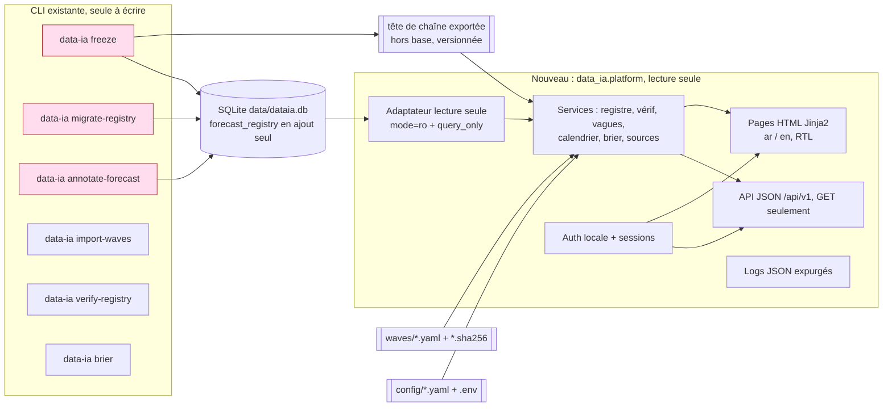
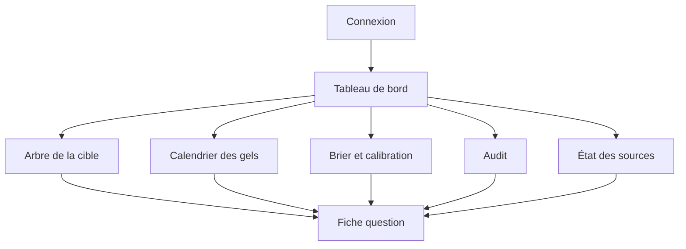
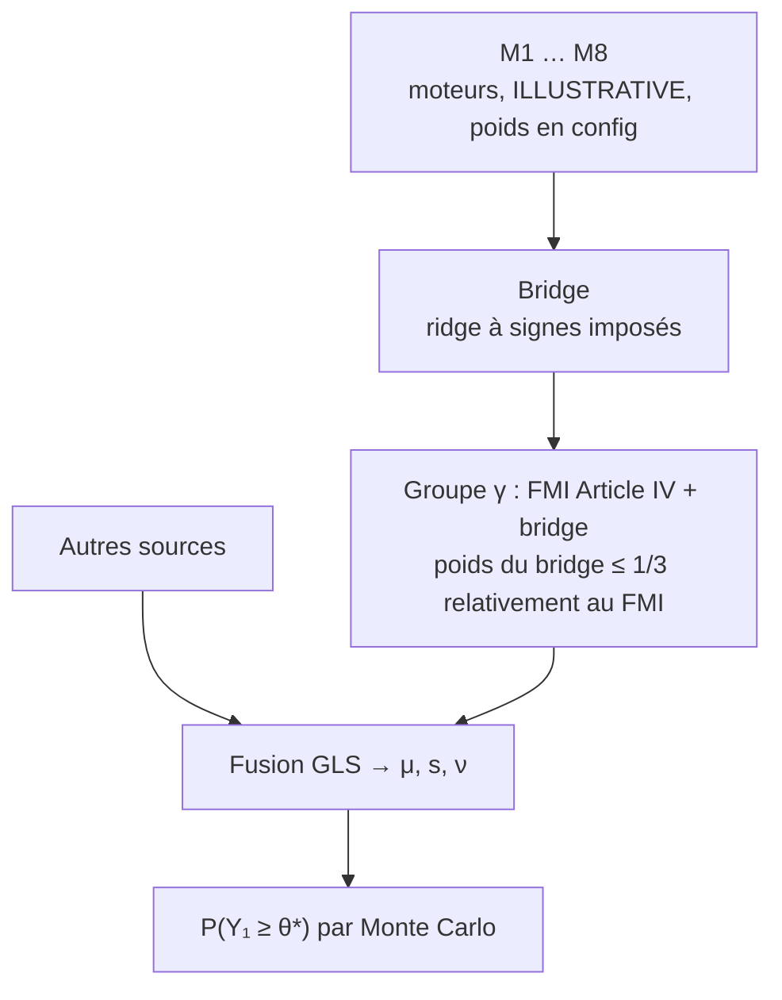

# BRIEF-5 — Plateforme et UI/UX de Data IA (orchestrateur, 18 nov. 2026)

Destinataire : Cursor CLI headless, lancé par Data IA · Dev sur le PC.
Repo : `C:\Users\Abderrahim\data`, branche `main`, local. Commits locaux uniquement.
Référence décisions et calendrier : `/workspace/data-ia/COORDINATION.md` (copie fournie par Dev). Ce fichier prime sur tout autre document, y compris sur ce brief.
Référence maths : `CAHIER-PASSE-4-MATHS.md`, v2.1.1 (SHA-256 94e7e54b7eb5ed25033d4336c310daabcee33b7303c84ecbc790691650e269f5), complété par la v2.2 pour la résolution de la cible (§1, §8 à §10).
Référence de style et d'état du code : BRIEF-4 avec son addendum, et BRIEF-4b (passes 4 et 4b terminées, 142 tests, 0 échec, rien n'est poussé).

> **Lancement.** Ce brief se lance seulement quand l'orchestrateur le décide et que l'utilisateur accepte la demande sur son PC. Il ne doit retarder ni la revue d'Évaluation (au plus tard le 28 nov.), ni le gel de production de P1 (au plus tard le 30 nov. 2026 à 23:59, heure de Riyad). En cas de conflit de temps, ces deux échéances passent avant.

---

## 0. Règles non négociables (à relire avant chaque lot)

1. **L'UI n'écrit jamais dans le registre de production.** Aucune route HTTP, aucun bouton, aucun job de l'UI n'insère, ne modifie, n'annote ni ne migre quoi que ce soit dans `forecast_registry`, ni dans la table d'annotations, ni dans la tête de chaîne exportée. **Le gel reste une commande CLI** (`data-ia freeze …`), lancée par Dev, avec l'accord de l'utilisateur sur son PC. L'UI peut au plus *afficher* la commande à lancer, sous forme de texte, sans jamais l'exécuter.
2. **Les données synthétiques sont toujours étiquetées SYNTHETIC.** Toute réponse de l'API porte son `data_label`. Toute page qui affiche une donnée SYNTHETIC porte un bandeau visible « SYNTHETIC » et un badge sur chaque valeur. On ne mélange jamais REAL et SYNTHETIC dans un même agrégat (même règle que `data_ia.math.labels`).
3. **Aucune valeur PMI n'est affichée** (licence S&P Global / Riyad Bank : usage interne seulement, aucune redistribution). Cela vaut pour l'UI, l'API, les exports et les logs. Pour les questions du groupe PMI (P1 et P2 de la vague 1, plus toute question future marquée PMI), on masque les valeurs de série, les observations, le seuil et l'ancre du seuil : « valeur masquée (licence S&P) ». La probabilité de Data IA et la base naïve, qui sont nos propres calculs, restent affichables. Voir le point À CONFIRMER n° 1 pour le libellé de la question.
4. **Aucun chiffre, endpoint ou terme inventé.** Toute valeur affichée vient du registre, des fichiers de vagues, des fichiers de bases, de la config ou d'une sortie du moteur. Si une donnée n'existe pas, on affiche « non disponible » ou « non calculé », jamais une valeur par défaut plausible. Pas de chiffre de démonstration en dur dans les gabarits.
5. **Pas de route interne.** L'UI ne fait **aucun appel réseau sortant** : elle lit la base et les fichiers locaux. SAMA, open.data.gov.sa et GASTAT `/o/` ne sont jamais appelés. La route GASTAT `gastatapi` reste désactivée en REAL tant qu'il n'est pas prouvé que c'est une API publique documentée autorisée par robots.txt. L'écran des sources affiche cet état, il ne le change pas. Scraping interdit : Umm Al-Qura, KAPSARC, Ookla, Saudi Exchange, Etimad.
6. **Aucun secret dans le repo.** Les clés vivent dans `.env` (déjà dans `.gitignore`). Le fichier des comptes locaux et la clé de session sont hors du repo, ou dans un chemin ignoré par git. **Les erreurs n'affichent aucune valeur d'environnement**, ni dans la page d'erreur, ni dans le JSON, ni dans les logs (même règle que pour l'erreur pydantic de l'addendum BRIEF-4).
7. **Pas de push** sans l'accord explicite de l'utilisateur. Seul Dev modifie le repo, sur le PC (`C:\Users\Abderrahim\data`, `main`). Ne jamais modifier `waves/` ni les fichiers `*.sha256`.
8. **Les tests existants restent verts** : au moins 142 tests passés, 0 échec, avant et après chaque lot. Aucun test existant n'est supprimé, désactivé ou assoupli.
9. **Le dossier de test est séparé de la production.** Les tests et la démo tournent sur des bases créées dans un dossier de test (`tmp_path` pour pytest, `data/test/` pour un lancement manuel ; chemin exact À CONFIRMER, n° 9). Ils n'ouvrent jamais `data/dataia.db` en écriture. Le seul test autorisé à lire la vraie base en copie reste celui de la passe 4b.
10. **Sobriété** : pas de Node, pas de bundler, pas de CDN, pas de télémétrie (PDPL). Les dépendances ajoutées sont listées et justifiées (§3).

---

## 1. Objectifs

Data IA est le moteur de décision pays de stc, en Arabie saoudite d'abord. Une question de décision devient un arbre de sous-questions vérifiables. Chaque sous-question reçoit une probabilité. Des prévisions sont gelées (registre en ajout seul, hash chaîné), puis notées au score de Brier face à une base naïve. C'est un produit interne de la Digital Factory de stc, vendable plus tard.

Question cible : « Will Saudi real non-oil activities grow by at least 4.5% in 2027, according to GASTAT's first estimate of 2027 annual real GDP? »

La plateforme doit :
- **O1 — Montrer la réponse et son pourquoi.** La probabilité de la cible, son intervalle, sa base naïve, ce qui la fait bouger (contributions et sensibilités), sans jamais surjouer la certitude.
- **O2 — Prouver.** Chaque chiffre renvoie à sa source, à son gel, à son hash. Un évaluateur peut revérifier la chaîne de hash depuis l'UI, en lecture seule, et retrouver le même verdict que `data-ia verify-registry`.
- **O3 — Être honnête sur l'état de la preuve.** Le score de Brier est affiché avec n et n_eff. Le verdict reste « non interprétable » tant que n_eff < 30. La conclusion formelle demande n_eff ≥ 50.
- **O4 — Piloter les gels.** Le calendrier des gels est visible, avec ce qui est gelé, ce qui reste à geler et l'échéance de chaque question. L'UI ne gèle pas.
- **O5 — Préparer un produit vendable** : API documentée, arabe et anglais avec RTL, accessibilité, authentification, configuration et logs propres. Sans dépasser ce qui est utile au pilote.

Non-objectifs de ce brief : maths de la passe 4 (items P1 et suivants du §10), arbre complet de la cible (passe 5), collecte de nouvelles sources, multi-pays, déploiement serveur ou cloud, SSO stc, Next.js.

## 2. Personas

| Persona | Ce qu'il veut en 2 minutes | Écrans principaux | Droits |
|---|---|---|---|
| **CTO ou VP Digital de stc** (décideur, sponsor) | La réponse à la question cible, sa fiabilité, et si le moteur bat la base naïve. Pas de jargon. | Tableau de bord, Brier et calibration (résumé), calendrier | Lecture du résumé |
| **Analyste** (Digital Factory, équipe Data IA) | Comprendre pourquoi la probabilité bouge, quelles sources pèsent, quelle question geler et quand. | Arbre, fiche question, sources, calendrier | Lecture complète, dont la config et les observations (hors PMI) |
| **Évaluateur** (Évaluation, audit interne, plus tard un client) | Vérifier que rien n'a été réécrit, que chaque prévision est antérieure à sa résolution, que les TEST et MANUAL sont hors du score. | Audit, fiche question, Brier | Lecture complète, plus l'export JSON du rapport de vérification (généré à la volée, jamais stocké dans le registre) |

Les trois rôles sont **en lecture seule**. Aucun rôle ne donne de droit d'écriture sur le registre.

## 3. Stack choisie et justification

### 3.1 Comparaison

| Option | Pour | Contre | Verdict |
|---|---|---|---|
| Garder Streamlit seul (déjà dans les dépendances) | Zéro nouvelle dépendance | Pas d'API, RTL et `lang`/`dir` difficiles à contrôler, accessibilité limitée, authentification artisanale, HTML peu maîtrisé | Gardé tel quel comme vue legacy, non étendu |
| **FastAPI + Jinja2, rendu côté serveur, HTML et CSS sans framework JS** | API et pages dans un seul process Python ; OpenAPI gratuit ; tests avec `TestClient` (httpx est déjà là) ; HTML maîtrisé, donc RTL et accessibilité propres ; pas de chaîne Node | 4 à 5 dépendances de plus | **Choisi** |
| Next.js en SPA (stack cible du deck) | Riche, cohérent avec la vision « Target » | Node, bundler, build, double stack, CSP plus dure ; disproportionné pour un pilote | Reporté (roadmap) |

Cohérence : le BRIEF d'origine prévoyait déjà « Streamlit or FastAPI + minimal HTML ». Le deck technique place Next.js dans la stack cible, pas dans la version 1.

### 3.2 Dépendances ajoutées

Toutes dans un extra optionnel `[ui]` de `pyproject.toml`, pour que le moteur et la CLI n'en dépendent pas : `fastapi`, `uvicorn`, `jinja2`, `itsdangerous` (cookie de session signé) et `python-multipart` (formulaire de connexion). Versions : bornes basses seulement, alignées sur ce que pip résout sur le PC. Ne pas inventer de numéros de version dans ce brief ; les relever au moment de l'installation.

Pas de dépendance pour : les graphiques (SVG généré côté serveur en Python), le hachage de mot de passe (`hashlib.scrypt` de la bibliothèque standard), les traductions (fichiers YAML lus avec `pyyaml`, déjà présent), les tests d'accessibilité (`html.parser` de la bibliothèque standard plus calcul de contraste en Python).

Polices : servies localement, jamais par CDN. Latin : IBM Plex Sans (licence OFL). Arabe : une police OFL couvrant l'arabe (par exemple IBM Plex Sans Arabic ou Noto Sans Arabic), à vendorer avec son fichier de licence ; choix final À CONFIRMER (n° 5).

## 4. Architecture plateforme

### 4.1 Vue d'ensemble



Principes :
- **Réutiliser le code existant** pour toute logique métier. La vérification de chaîne de l'UI appelle *la même fonction Python* que `verify-registry`, sans la recopier. Même chose pour la vérification des vagues (`import-waves --verify-only`) et pour le rapprochement de `brier`. Si une fonction n'est disponible que dans la CLI, on l'extrait vers un module sans changer son comportement, et ses tests existants restent verts.
- **Aucune logique de calcul dans les gabarits.** Les gabarits affichent ce que les services renvoient.

### 4.2 Arborescence proposée

```
src/data_ia/platform/
  __init__.py
  app.py            # create_app(settings) ; monte /api/v1 et les pages
  readonly.py       # ouverture lecture seule de la base
  settings.py       # PlatformSettings (pydantic-settings), erreurs expurgées
  auth.py           # comptes locaux, scrypt, sessions, rôles
  logging.py        # logs JSON, filtre d'expurgation
  i18n.py           # chargement ar/en, t(), dir()
  masking.py        # règle PMI (licence S&P)
  services/
    registry.py  verify.py  waves.py  calendar.py
    brier.py     sources.py  target.py  tree.py
  api/v1.py         # routes GET
  web/routes.py     # pages HTML
  templates/        # Jinja2 (base.html, partials, une page par écran)
  static/css/       # tokens.css, base.css (propriétés logiques, RTL)
  static/fonts/     # polices OFL + LICENSE
  locales/en.yaml  locales/ar.yaml
  svg/              # générateurs de graphiques SVG
tests/platform/     # nouveaux tests, fixtures créées dans tmp_path
```

Commande CLI ajoutée : `data-ia ui [--host 127.0.0.1] [--port N] [--env test|prod]`, plus `data-ia ui-user add|list|disable` pour les comptes locaux (écrit uniquement le fichier des comptes, jamais la base). Le port par défaut ne doit pas entrer en conflit avec `DASHBOARD_PORT` (Streamlit, 8501).

### 4.3 Accès lecture seule (lot 1, en premier)

- SQLite : connexion par URI `file:<chemin>?mode=ro` avec `uri=True`, puis `PRAGMA query_only = ON`. Moteur SQLAlchemy dédié à l'UI, distinct de celui de la CLI. Aucun `init_db()`, aucun `create_all`, aucune migration ni installation de trigger depuis l'UI.
- Si la base n'existe pas : l'UI affiche « base absente » et ne la crée pas.
- Si le schéma est antérieur à la migration 4b (colonne `prev_sha256` absente) : l'UI affiche « schéma non migré : lancer `data-ia migrate-registry` (Dev, avec accord) » et n'essaie rien.
- PostgreSQL (optionnel dans le repo) : l'UI exige une URL distincte (`DATAIA_UI_DATABASE_URL`) qui pointe vers un rôle en lecture seule, plus `SET default_transaction_read_only = on`. La création du rôle est hors de ce brief (À CONFIRMER, n° 10). Par défaut : SQLite.
- Les noms exacts des colonnes et tables (`prev_sha256`, `p_base`, `baseline_method`, `series_id`, `vintage_sha256`, `observations_content_hash`, `seed_hash`, `wave_id`, table d'annotations, etc.) se lisent **dans le code des passes 4 et 4b**, pas dans ce brief.

### 4.4 API en lecture seule (`/api/v1`, JSON, GET et HEAD seulement)

Toute réponse contient `data_label` (REAL, SYNTHETIC, ou `mixed: refused`), `env` (test ou prod), `generated_at` (ISO 8601 avec fuseau Asia/Riyadh) et, si des données sont masquées, `masked: ["pmi_licence"]`.

| Route | Contenu | Source |
|---|---|---|
| `GET /api/v1/health` | version, git commit, env, état de la base (présente, migrée), lecture seule confirmée | process, base |
| `GET /api/v1/registry/rows` | lignes du registre, paginées (id, question_id, wave_id, forecast_at, data_cutoff, probability, intervalle, p_base, baseline_method, data_label, sha256, prev_sha256, statut legacy/genèse/chaîne, annotations) | registre |
| `GET /api/v1/registry/rows/{id}` | une ligne, avec tous ses hash | registre |
| `GET /api/v1/registry/verify` | rapport de vérification calculé à la volée : legacy (ancien hash), genèse, chaîne, trous d'id, tête exportée contre tête en base, annotations | fonction de `verify-registry` |
| `GET /api/v1/waves` et `/waves/{id}` | vagues, hash attendu contre hash calculé, questions (avec masquage PMI), errata | `waves/`, `*.sha256`, errata |
| `GET /api/v1/questions/{wave}/{qid}` | fiche : texte, série, comparateur, seuil, ancre, échéance, source de résolution, base, historique des gels, annotations | vagues, bases, registre |
| `GET /api/v1/calendar` | échéances de gel (heure de Riyad), statut de chaque question | config du calendrier (BRIEF-4 C), registre |
| `GET /api/v1/brier` | rapprochement de `brier` : n, n_eff si calculé, Brier moteur, Brier base, BSS, exclusions (TEST, MANUAL, VOID, tardives) | fonction de `brier` |
| `GET /api/v1/calibration` | bacs de fiabilité si n suffit, sinon `status: insufficient` | idem |
| `GET /api/v1/sources` | registre des sources, classe, a priori, accès, licence, mode (REAL, stub, désactivé), dernier statut connu | `sources.yaml`, `sources_verified.yaml`, provenance |
| `GET /api/v1/target` | état de la cible : statut (`not ready` tant que l'arbre est vide), P, intervalle, μ, s, ν, quantiles 5/50/95 **si le moteur les a produits**, base, référence « FMI au seuil », écart de définition FMI/GASTAT | sorties du moteur, config `resolution` |
| `GET /api/v1/target/tree` | arbre, contributions et sensibilités si produites | sorties du moteur, `taxonomy` |

Règles :
- Toute méthode autre que GET ou HEAD renvoie 405, sauf `POST /auth/login` et `POST /auth/logout`, qui ne touchent pas la base.
- OpenAPI exposée sur `/api/v1/openapi.json`, réservée aux utilisateurs connectés.
- Ce sont des routes **internes à Data IA**. Elles ne remplacent ni n'imitent aucune API externe.

### 4.5 Authentification locale

- Comptes locaux dans un fichier hors repo (par défaut sous `data/ui/`, ignoré par git ; chemin en config). Mot de passe haché avec `hashlib.scrypt` et un sel par compte. Création par `data-ia ui-user add` avec saisie masquée (`getpass`), jamais en argument de ligne de commande.
- Rôles : `viewer` (CTO, VP Digital), `analyst`, `evaluator`. Tous en lecture seule.
- Session : cookie signé (`itsdangerous`), `HttpOnly`, `SameSite=Strict`, expiration configurable. Jeton CSRF sur les deux formulaires (login, logout). Limitation des essais de connexion en mémoire.
- Écoute par défaut sur `127.0.0.1`. Écouter sur une autre interface demande `--host` explicite et un avertissement dans les logs. Pas de HTTPS dans ce brief (usage local). Exposer l'UI sur le réseau stc est hors périmètre (À CONFIRMER, n° 11).
- La clé de signature vient de `.env` (`DATAIA_UI_SECRET_KEY`) ; l'UI refuse de démarrer si elle manque ou si elle est trop courte. Elle n'est jamais journalisée.

### 4.6 Configuration

`PlatformSettings` (pydantic-settings), lue depuis `.env`, avec des valeurs par défaut sûres :
- `DATAIA_ENV` = `test` par défaut. En `test`, l'UI refuse d'ouvrir `data/dataia.db` et utilise la base du dossier de test. En `prod`, elle ouvre la base de production **en lecture seule**. `prod` doit être demandé explicitement (`--env prod` ou variable).
- `DATAIA_UI_HOST`, `DATAIA_UI_PORT`, `DATAIA_UI_SECRET_KEY`, `DATAIA_UI_USERS_PATH`, `DATAIA_UI_SESSION_MINUTES`, `DATAIA_UI_DEFAULT_LOCALE` (`ar` ou `en`), `DATAIA_UI_DATABASE_URL` (optionnelle).
- Chemins vers `waves/`, la tête de chaîne exportée, la config du calendrier : relus depuis la config existante, pas recopiés.
- `.env.example` mis à jour avec des valeurs vides ou factices clairement marquées, jamais une vraie clé.
- **Erreurs de configuration expurgées** : un échec de validation affiche le nom du champ et la raison, jamais la valeur (`hide_input_in_errors` côté pydantic, plus un formatage maison si besoin).

### 4.7 Logs

- Logs JSON (une ligne par évènement) vers la console et vers `logs/platform.log` (dossier ignoré par git), avec rotation.
- Champs : horodatage (Asia/Riyadh), niveau, route, méthode, statut, durée, utilisateur (identifiant), rôle, id de corrélation.
- Filtre d'expurgation : aucune valeur d'environnement, aucun cookie, aucun mot de passe, aucun jeton, aucune valeur PMI. Les exceptions sont journalisées avec leur type et leur pile, sans les variables locales.
- La page d'erreur montre un message générique et l'id de corrélation, rien d'autre.
- Un évènement d'audit d'accès est journalisé pour chaque export du rapport de vérification.

## 5. Écrans

Conventions communes :
- Bandeau d'environnement en haut de chaque page : « TEST » ou « PRODUCTION (lecture seule) ».
- Badges d'état standard, toujours texte plus icône, jamais la couleur seule : `REAL`, `SYNTHETIC`, `TEST`, `MANUAL`, `LEGACY`, `GENÈSE`, `ILLUSTRATIVE`, `PROVISIONAL`, `NOT READY`, `VOID`, `MASQUÉ (licence S&P)`.
- Heures affichées en heure de Riyad, avec l'étiquette « heure de Riyad (UTC+3) ». Dates grégoriennes (calendrier hégirien : À CONFIRMER, n° 6).
- Hash affichés tronqués (8 premiers et 6 derniers caractères, comme dans COORDINATION), en police à chasse fixe, isolés en `dir="ltr"` (`<bdi>`), avec un bouton pour copier la valeur complète.
- Probabilités en pourcentage entier, avec l'intervalle quand il existe. Jamais plus de précision que ce que le moteur garantit.
- Tout graphique SVG a un titre, une description et un tableau de données équivalent juste en dessous.

### 5.1 Navigation



### 5.2 Tableau de bord (persona : CTO, VP Digital)

Contenu :
- La question cible, en entier, dans sa langue d'origine (anglais, `lang="en"`), avec une traduction arabe seulement si une traduction validée existe (À CONFIRMER, n° 4).
- La probabilité P(Y₁ ≥ θ*) **si le moteur l'a produite**, avec l'intervalle et les quantiles 5/50/95 de Y₁. Sinon, l'état réel : « NOT READY : arbre de la cible vide, prévu en passe 5 ». Aucune valeur de remplacement.
- Règle de résolution, lue dans la config `resolution` : le taux « Non-Oil Activities » écrit dans le texte du flash T4 2027 de GASTAT, à 1 décimale ; 4,5 pile = OUI ; θ* dérivé de la config (4,45 avec `half_up`), jamais écrit en dur dans le gabarit. Date attendue du flash : vers le 1er févr. 2028, [à confirmer] ; question annulée si rien n'est publié avant le 31 mars 2028.
- Base naïve formelle : fréquence des premières publications 2018-2025, 2020 incluse, règle de Laplace (k+1)/10, avec la variante sans 2020 en sensibilité. Affichée seulement si la valeur est calculée et stockée.
- Référence affichée « FMI au seuil » (Article IV) et avertissement sur l'écart de définition : le seuil vient du « non-oil GDP » du FMI, la résolution porte sur les « non-oil activities » de GASTAT ; pas de conversion fixe.
- Encadré « État de la preuve » : nombre de questions gelées, tranchées, n_eff, et le verdict (« non interprétable » tant que n_eff < 30).
- Prochain gel (question et échéance), avec un lien vers le calendrier.

Wireframe (LTR ; en arabe, l'ordre des colonnes est inversé) :

```
┌──────────────────────────────────────────────────────────────────────────┐
│ [PRODUCTION · lecture seule]   Data IA            [EN | ع]   user ▾  ⎋    │
├──────────────────────────────────────────────────────────────────────────┤
│ Question cible                                                           │
│ "Will Saudi real non-oil activities grow by at least 4.5% in 2027, …"    │
│ ┌──────────────────────┐ ┌─────────────────────────┐ ┌─────────────────┐ │
│ │ Probabilité          │ │ Base naïve (formelle)    │ │ Référence FMI   │ │
│ │  [NOT READY]         │ │  non calculée            │ │  au seuil       │ │
│ │  ou  NN %  [a–b]     │ │  ou  valeur + méthode    │ │  (affichée)     │ │
│ └──────────────────────┘ └─────────────────────────┘ └─────────────────┘ │
│ Résolution : flash T4 2027 GASTAT · 1 décimale · 4,5 = OUI · θ* (config)│
│ ⚠ Écart de définition FMI / GASTAT : pas de conversion fixe              │
├───────────────────────────────┬──────────────────────────────────────────┤
│ État de la preuve             │ Prochains gels (heure de Riyad, UTC+3)   │
│ gelées · tranchées · n_eff    │ P1 · 30 nov. 23:59 · à geler   → fiche   │
│ verdict : non interprétable   │ P7 · 6 déc. 09:00  · à geler   → fiche   │
└───────────────────────────────┴──────────────────────────────────────────┘
```

### 5.3 Arbre de sous-questions, contributions et sensibilités (persona : analyste)

Structure attendue de la cible (cahier §4 et §5) : pour la racine continue, **pas d'agrégation logit**. Les moteurs M1 à M8 alimentent une équation de passage (bridge) ; le bridge entre comme une source, dans un groupe γ avec le FMI (Article IV), avec un poids plafonné à 1/3 relativement au FMI (paramètre de config) ; fusion GLS ; loi prédictive ; P par Monte Carlo.



Contenu :
- Arbre repliable au clavier (liste imbriquée accessible, `role="tree"`), pas un canvas.
- Pour chaque nœud : libellé, statut, data_label, valeur ou probabilité si produite, poids w_k, contribution, sensibilités.
- Sensibilités : celles du cahier §4 (∂P/∂μ, ∂P/∂f_k, ∂P/∂b̂_k, ∂P/∂σ_t), calculées par le moteur, sur l'approximation Student-t, avec la mention « P publiée = Monte Carlo ». Pour une question binaire composée : sensibilités de l'agrégation logit, si le moteur les fournit.
- Vue « retirer un moteur » : affiche l'effet du retrait tel que le moteur le calcule (cahier §5). L'UI ne recalcule rien.
- Si l'arbre de la cible est vide : on affiche la structure ci-dessus en `ILLUSTRATIVE`, sans aucun chiffre, et le message « arbre prévu en passe 5 ».
- Les libellés de M1 à M8 se lisent dans la config ou la page Produit ; s'ils manquent, on affiche « M1 », « M2 », etc. (À CONFIRMER, n° 3).

Wireframe :

```
┌ Arbre de la cible ──────────────────────────────── [ILLUSTRATIVE] ───────┐
│ ▾ P(Y₁ ≥ θ*)            P : — (NOT READY)                                │
│   ▾ Fusion GLS          μ —   s —   ν —                                  │
│     ▸ FMI Article IV    w —   ∂P/∂f —   b̂ (variance large)               │
│     ▾ Bridge            w — (≤ 1/3 rel. FMI)                              │
│        M1 … M8          poids (config) · ∂P/∂f_k · effet du retrait       │
│     ▸ Autres sources                                                      │
├───────────────────────────────────────────────────────────────────────────┤
│ Sensibilités (barres SVG + tableau)   |  « Retirer un moteur » (moteur)   │
└───────────────────────────────────────────────────────────────────────────┘
```

### 5.4 Fiche d'une question (personas : analyste, évaluateur)

Contenu :
- Identité : vague, id, texte, moteur (driver), groupe de corrélation, série, comparateur, seuil et ancre (masqués si PMI), échéance, source de résolution, règle d'égalité et règle du point précédent (lues dans `rules` de la vague), errata qui la concernent (par exemple E1 à E5 de `vague1_errata.md`).
- Base : méthode (persistance v3, fréquence, ou 0,5 justifié), règle R1 ou R2, valeur p_base au data_cutoff, lien vers le fichier de bases et son hash (`vague1_bases_valeurs.yaml`, etc.).
- Sources et données : série hachée (fichier et SHA-256), millésime (vintage_sha256), observations utilisées (masquées si PMI), data_label.
- **Historique des gels** : chaque ligne du registre pour cette question, avec forecast_at, data_cutoff, probabilité, p_base, git_commit, config_hash, sha256, prev_sha256, statut (legacy, genèse, chaîne) et annotations (TEST, avec la raison).
- Gel attendu : échéance du calendrier, statut, et la **commande CLI à lancer par Dev, en texte seulement**, avec la mention « accord de l'utilisateur requis sur le PC ». Syntaxe exacte lue dans `data-ia freeze --help` (À CONFIRMER, n° 8).
- Résolution : issue, date, publication, statut VOID le cas échéant.

Wireframe :

```
┌ P3 · vague 1 · driver M5 · groupe G_BCI ─────────────── [REAL] ─────────┐
│ "Will GASTAT's Business Confidence Index for Nov 2026 be at or above …" │
│ Série : GASTAT BCI headline · comparateur >= · seuil (vague) · échéance │
│ Source de résolution · règles (égalité, point précédent) · errata       │
├──────────────────────────────┬──────────────────────────────────────────┤
│ Base                          │ Gel attendu                              │
│ persistance v3 · R1/R2        │ 7 déc. 09:00 (heure de Riyad) · à geler │
│ p_base @ data_cutoff          │ $ data-ia freeze … (texte, non exécuté) │
│ fichier de bases + sha256     │ accord utilisateur requis               │
├──────────────────────────────┴──────────────────────────────────────────┤
│ Historique des gels                                                      │
│ id │ forecast_at │ data_cutoff │ P │ p_base │ sha256 │ prev │ statut │ ⓘ │
└──────────────────────────────────────────────────────────────────────────┘
```

### 5.5 Calendrier des gels (personas : tous)

- Source unique : la config du calendrier implémentée en passe 4 (BRIEF-4 C), en heure de Riyad. Le gabarit n'écrit aucune date en dur.
- Valeurs attendues au 18 nov. (COORDINATION, calendrier corrigé de 02:40), utilisées **uniquement** comme vérification dans un test contre la config : P17 dès que possible ; P1 le 30 nov. 2026 à 23:59 ; P7 le 6 déc. à 09:00 ; P3 le 7 déc. à 09:00 ; P9 le 8 déc. à 09:00 ; P5 le 11 déc. à 23:59 ; P11, P12, P14 et P15 le 29 déc. à 09:00 ; P10 le 8 janv. 2027 à 23:59 ; P6 avant le 25 janv. ; P8, P13 et P16 avant le 10 févr. P2 et P4 : janvier, date exacte À CONFIRMER (n° 7). Vague 2 : dates À CONFIRMER (n° 2).
- Statuts calculés : `gelée` (ligne valide dans le registre avant l'échéance), `à geler`, `échéance < 48 h`, `en retard` (échéance passée sans gel : le moteur refuse de geler), `MANUAL` (prévision manuelle de Modèle, hors du score du moteur), `VOID`.
- Vue liste (par défaut, accessible) plus vue chronologique SVG.
- Rappel en tête : « l'UI ne gèle pas ; le gel est une commande CLI avec accord de l'utilisateur ».

```
┌ Calendrier des gels · heure de Riyad (UTC+3) ───────────────────────────┐
│ Filtre : [vague ▾] [statut ▾]                       [liste | frise]     │
│ Q    │ échéance de gel       │ publication attendue │ statut      │     │
│ P17  │ dès que possible      │ budget FY2027        │ à geler     │ → │
│ P1   │ 30 nov. 2026 23:59    │ (masqué : PMI)       │ < 48 h ⚠    │ → │
│ P7   │ 6 déc. 2026 09:00     │ comptes T3 GASTAT    │ à geler     │ → │
└──────────────────────────────────────────────────────────────────────────┘
```

### 5.6 Score de Brier et calibration (personas : CTO en résumé, évaluateur en détail)

- Données : le rapprochement de `brier` (BRIEF-4 E et B1) : une seule prévision par question, la dernière gelée avant l'échéance ; toute prévision postérieure à la résolution ou à l'échéance est rejetée ; lignes annotées TEST exclues ; MANUAL exclues du score du moteur et affichées à part ; VOID exclues ; REAL et SYNTHETIC jamais mélangés.
- Indicateurs : n tranchées, n_eff (si le moteur le calcule ; sinon « non calculé », À CONFIRMER, n° 12), Brier du moteur, Brier de la base naïve, BSS, avec intervalle bootstrap si le moteur le fournit.
- Verdict, en clair : « non interprétable » tant que n_eff < 30 (`BRIER_MIN_N` = 30 en config) ; « point d'étape » à 30 ; conclusion formelle à partir de 50. Phrase de référence du deck : point d'étape à 30 questions effectives tranchées d'ici mai 2027, conclusion à 50 entre mi-juin et début novembre 2027, selon la corrélation entre vagues mesurée.
- Calibration : diagramme de fiabilité (SVG plus tableau) seulement si le nombre de questions le permet ; règle de découpage en bacs À CONFIRMER par Modèle (n° 13). Sinon : « échantillon insuffisant ».
- Liste des exclusions, avec la raison de chacune (lien vers la fiche).

```
┌ Brier et calibration ────────────────────────────────── [REAL] ─────────┐
│ Verdict : NON INTERPRÉTABLE (n_eff < 30)                                │
│ n tranchées — · n_eff — · Brier moteur — · Brier base — · BSS —         │
├───────────────────────────────┬──────────────────────────────────────────┤
│ Diagramme de fiabilité (SVG)  │ Exclusions : TEST · MANUAL · VOID ·     │
│ ou « échantillon insuffisant »│ tardives (raison, lien fiche)            │
└───────────────────────────────┴──────────────────────────────────────────┘
```

### 5.7 État des sources (persona : analyste)

- Registre : `sources.yaml`, `sources_verified.yaml`, `source_priors.yaml` (noms exacts dans le repo). Pour chaque source : nom, URL publique, classe (A 0,90 ; B 0,80 ; C 0,75 ; D 0,50 ; ajustement ±0,10), a priori, accès, licence, clé requise (oui ou non, jamais la valeur), fréquence.
- Mode : `REAL`, `stub (SYNTHETIC)`, `désactivé`. Cas affichés explicitement : `gastatapi` désactivé en REAL (non prouvé public) ; SAMA et open.data.gov.sa sans API exploitable ; GASTAT `/o/` interdit par robots.txt ; liste des sites interdits au scraping.
- Dernier statut connu : lu dans la provenance stockée par les collecteurs (horodatage, hash, version de l'extracteur). L'UI ne lance aucun collect.
- Licences : badge « usage interne seulement » pour le PMI S&P ; « [à confirmer] » partout où le registre le dit.

### 5.8 Audit : vérification de la chaîne de hash (persona : évaluateur)

- Bouton « Revérifier maintenant » : un **GET** qui appelle la même fonction que `verify-registry`, en lecture seule, et affiche le rapport. Résultat attendu sur la production actuelle (compte rendu de la passe 4b) : 6 lignes ; lignes 1 à 5 legacy, vérifiées selon l'ancien hash ; ligne 6 genèse ; ligne 5 annotée TEST ; aucune incohérence ; tête exportée conforme.
- Sections : lignes legacy ; genèse (avec le hash de l'ensemble des lignes legacy) ; chaîne ligne par ligne (sha256 recalculé contre sha256 stocké, prev_sha256 contre sha256 précédent) ; trous d'id ; tête de chaîne en base contre tête exportée hors base (fichier versionné ; chemin lu dans la config, À CONFIRMER n° 14) ; annotations ; vagues (hash attendu contre hash calculé pour chaque `waves/*.sha256`, comme `import-waves --verify-only`).
- Verdict global : `OK` ou `ÉCHEC`, avec la première ligne en défaut et le type de défaut (réécriture, suppression, rupture de chaîne, tête divergente, hash de vague faux).
- Export JSON du rapport, généré à la volée, réservé au rôle `evaluator`, avec horodatage et git commit. Rien n'est écrit dans la base.

```
┌ Audit · chaîne de hash ────────────────────── [Revérifier maintenant] ─┐
│ Verdict : OK  (ou ÉCHEC : ligne N, réécriture)   vérifié à HH:MM (Riyad)│
├─────────────────────────────────────────────────────────────────────────┤
│ Legacy (ancien hash)   1 ✓  2 ✓  3 ✓  4 ✓  5 ✓ [TEST]                   │
│ Genèse                 6 ✓  hash(legacy) = ab12cd…ef3456                 │
│ Chaîne                 7 … N  (sha256 ✓ · prev ✓)                        │
│ Tête en base  = tête exportée ✓     Trous d'id : aucun                   │
│ Vagues : vague1 ✓ · vague1b ✓ · bases ✓ …                                │
│ [Exporter le rapport JSON]  (évaluateur)                                 │
└─────────────────────────────────────────────────────────────────────────┘
```

## 6. Design system

- **Tokens** dans `static/css/tokens.css` : couleurs (fond, surface, texte, texte secondaire, bordure, accent, états succès, alerte, erreur, info), espacements sur une échelle de 4 px, rayons, typographie (2 tailles de titre, corps, petit, chasse fixe pour les hash), ombres minimales.
- **Palette** : neutre par défaut. Couleurs de marque stc À CONFIRMER (n° 5) : ne pas les deviner, prévoir une seule variable `--accent` à remplacer.
- **Contraste** : texte ≥ 4,5:1, grands textes et éléments d'interface ≥ 3:1 (WCAG 2.1 AA), vérifié par un test qui lit `tokens.css`.
- **Composants** (partials Jinja2) : en-tête avec bandeau d'environnement, sélecteur de langue, carte d'indicateur, badge d'état, tableau triable sans JS (tri côté serveur par paramètre d'URL), arbre accessible, bloc hash avec copie, bannière SYNTHETIC, encadré « masqué (licence S&P) », graphique SVG avec tableau, page vide, page d'erreur.
- **États vides et d'erreur** : chaque écran a un état vide honnête (« aucune prévision gelée », « non calculé », « NOT READY ») et un état d'erreur sans détail technique.
- **JavaScript** : facultatif et minimal (copier un hash, replier l'arbre). Tout fonctionne sans JS. Aucun script en ligne : CSP stricte (`default-src 'self'`).

## 7. Arabe, anglais et RTL

- Deux langues : `en` et `ar`, sélection par paramètre ou préférence de session ; langue par défaut en config. `<html lang="ar" dir="rtl">` ou `<html lang="en" dir="ltr">` selon la langue.
- Mise en page en **propriétés CSS logiques** (`margin-inline-start`, `padding-inline`, `inset-inline-end`, `text-align: start`). Aucun `left` ou `right` en dur, vérifié par un test qui parcourt les CSS.
- Les icônes directionnelles (flèches, chevrons) sont inversées en RTL ; les icônes non directionnelles ne le sont pas.
- Contenu en langue d'origine (questions, séries, noms de publication, citations de documents) : affiché tel quel avec `lang` et `dir` propres (`<bdi>`), jamais traduit par machine. Une traduction arabe n'est affichée que si elle a été fournie et validée (À CONFIRMER, n° 4).
- Chaînes d'interface dans `locales/en.yaml` et `locales/ar.yaml`, mêmes clés dans les deux fichiers (vérifié par test). Les chaînes arabes rédigées par l'agent sont marquées « à relire » dans le fichier, en attendant une relecture par un arabophone (n° 4).
- Chiffres : chiffres latins par défaut dans les deux langues (à confirmer, n° 6). Nombres, pourcentages, dates et hash isolés en LTR dans une phrase arabe.
- Graphiques : l'axe du temps reste de gauche à droite dans les deux langues, par défaut ; titres et légendes traduits (À CONFIRMER, n° 6).

## 8. Accessibilité (cible WCAG 2.1 AA)

- Structure : un seul `h1` par page, titres hiérarchiques, repères `header`, `nav`, `main`, `footer`, lien « aller au contenu ».
- Clavier : tout est accessible au clavier, focus visible, ordre logique dans les deux sens de lecture, arbre navigable avec les flèches selon le modèle ARIA `tree`.
- Couleur jamais seule porteuse d'information (badges avec texte et icône).
- Graphiques : `role="img"`, `<title>` et `<desc>`, plus un tableau de données équivalent.
- Formulaires : `label` explicite, messages d'erreur liés au champ (`aria-describedby`), pas de limite de temps sans avertissement.
- Mouvement : pas d'animation, ou respect de `prefers-reduced-motion`.
- Zoom à 200 % sans perte de contenu ; mise en page fluide jusqu'à une largeur de tablette.

## 9. Lots priorisés et critères d'acceptation

Chaque lot : commits locaux séparés (code, puis tests), `pytest` complet vert (≥ 142 passés, 0 échec, en plus des nouveaux tests), aucun fichier de `waves/` touché, aucun push. Compte rendu à Dev après chaque lot.

### Lot 0 — État des lieux et garde-fous (priorité absolue, préalable à tout)
À faire :
- Lire `git log --oneline -15`, `data-ia --help` et l'aide de chaque sous-commande (`freeze`, `verify-registry`, `import-waves`, `brier`, `migrate-registry`, `annotate-forecast`, `replay`), le schéma réel du registre et de la table d'annotations, l'emplacement de la tête de chaîne exportée et de la config du calendrier. Écrire `docs/PLATFORM-INVENTORY.md` avec ce qui existe vraiment, en citant les fichiers.
- Lancer `pytest` et consigner le total de référence.
- Ajouter l'extra `[ui]`, l'entrée `.gitignore` pour `data/ui/`, `data/test/` et `logs/`.

Critères d'acceptation :
- A0.1 `docs/PLATFORM-INVENTORY.md` existe et chaque table, colonne et commande citée y est référencée par un chemin de fichier du repo.
- A0.2 `pytest` : même nombre de tests passés qu'avant le lot (≥ 142), 0 échec.
- A0.3 `git check-ignore data/ui/x data/test/x logs/x .env` renvoie les quatre chemins.

### Lot 1 — Accès lecture seule et API registre (priorité 1, livrable minimal utile à Évaluation)
À faire : `platform/readonly.py`, `settings.py` (sans auth pour l'instant, écoute sur 127.0.0.1 seulement), services `registry` et `verify`, routes `health`, `registry/rows`, `registry/rows/{id}`, `registry/verify`, `waves`. Fixtures : bases construites dans `tmp_path` avec la CLI ou les fonctions existantes (ancien schéma migré, chaîne saine, chaîne altérée, ligne supprimée, ligne annotée TEST).

Critères d'acceptation :
- A1.1 Toute tentative d'écriture via l'adaptateur (`INSERT`, `UPDATE`, `DELETE`, `CREATE`) lève une erreur ; un test le prouve sur SQLite.
- A1.2 Chaque route de l'application est inspectée par un test : aucune route n'accepte POST, PUT, PATCH ou DELETE, sauf `/auth/login` et `/auth/logout` ; les autres méthodes renvoient 405.
- A1.3 Le fichier de base de test a le même SHA-256 avant et après une session complète d'appels à l'API.
- A1.4 Sur les fixtures, `GET /api/v1/registry/verify` donne le même verdict que `data-ia verify-registry` (code 0 contre OK, code non nul contre ÉCHEC), y compris sur une réécriture cohérente et sur une suppression.
- A1.5 En `DATAIA_ENV=test`, demander la base `data/dataia.db` est refusé avec un message clair ; en `prod` sans demande explicite, l'UI ne démarre pas.
- A1.6 Base absente : `health` répond « base absente » et aucun fichier n'est créé. Schéma non migré : message « schéma non migré », aucune écriture.
- A1.7 Toute réponse JSON contient `data_label`, `env` et `generated_at` avec le fuseau +03:00.
- A1.8 Aucun appel réseau : un test qui remplace `socket.socket.connect` par une fonction qui lève une erreur passe sur toutes les routes.

### Lot 2 — Authentification locale, configuration, logs (priorité 2)
Critères d'acceptation :
- A2.1 Sans session, toute page et toute route `/api/v1/*` (sauf `health` en mode minimal) renvoient 401 ou redirigent vers la connexion.
- A2.2 Les mots de passe sont stockés hachés avec scrypt et un sel unique ; deux comptes avec le même mot de passe ont des hash différents ; le fichier des comptes n'est pas suivi par git.
- A2.3 Cookie de session `HttpOnly` et `SameSite=Strict` ; un cookie modifié est refusé ; un POST de connexion sans jeton CSRF est refusé.
- A2.4 Un test pose une variable d'environnement canari (par exemple `DATAIA_UI_SECRET_KEY` et une variable inventée pour le test), provoque une erreur de configuration et une erreur 500 : la valeur canari n'apparaît ni dans la réponse, ni dans les logs capturés.
- A2.5 Les logs sont du JSON valide, ligne par ligne, avec l'id de corrélation renvoyé dans l'en-tête de réponse.
- A2.6 L'export du rapport d'audit est refusé aux rôles `viewer` et `analyst` (403) et accepté pour `evaluator`.
- A2.7 L'UI refuse de démarrer sans clé de session ou avec une clé trop courte, sans afficher la clé.

### Lot 3 — Socle UI, design system, i18n, et écrans Audit, Fiche question, Calendrier (priorité 3 : utiles pour les gels de novembre et décembre)
Critères d'acceptation :
- A3.1 Chaque page rendue en `ar` a `lang="ar" dir="rtl"`, en `en` `lang="en" dir="ltr"` (test sur toutes les pages).
- A3.2 `locales/en.yaml` et `locales/ar.yaml` ont exactement les mêmes clés ; aucune chaîne d'interface en dur dans les gabarits (test qui cherche du texte hors `t()` dans les gabarits, avec une liste blanche pour les badges techniques).
- A3.3 Aucune propriété `left`, `right`, `margin-left`, `margin-right`, `padding-left`, `padding-right`, `float: left` ou `float: right` dans les CSS (test).
- A3.4 Contraste des paires de tokens texte et fond ≥ 4,5:1 (test qui calcule le ratio WCAG depuis `tokens.css`).
- A3.5 Accessibilité structurelle (test `html.parser` sur chaque page) : un seul `h1`, un `main`, un lien d'évitement, tous les `img` et `svg` porteurs de sens ont une alternative, tous les champs ont un `label`.
- A3.6 Audit : sur la fixture saine, verdict OK avec legacy, genèse, chaîne et tête conforme ; sur la fixture altérée, verdict ÉCHEC avec le bon numéro de ligne et le bon type de défaut.
- A3.7 Fiche question : pour P1 et P2 (groupe PMI), ni l'API ni la page ne contiennent une seule valeur de la série PMI : un test charge les valeurs de la série PMI de la fixture et vérifie qu'aucune n'apparaît dans le HTML, le JSON ou les logs ; le seuil et l'ancre sont remplacés par l'encadré « masqué (licence S&P) » ; la probabilité et la base restent affichées.
- A3.8 Calendrier : les échéances affichées viennent de la config ; un test compare la config aux valeurs de COORDINATION listées au §5.5 et échoue si l'une diffère ; changer une date dans une config de test change l'affichage sans toucher aux gabarits.
- A3.9 La commande de gel affichée est du texte : aucune route ne lance de sous-processus (test qui remplace `subprocess.run` et `subprocess.Popen` par une fonction qui lève une erreur).
- A3.10 Toute donnée SYNTHETIC rendue porte le bandeau « SYNTHETIC » dans la page et `data_label: SYNTHETIC` dans le JSON ; une fixture qui mélange REAL et SYNTHETIC dans un agrégat est refusée.
- A3.11 Les heures affichées portent l'étiquette « heure de Riyad (UTC+3) » ; une ligne du registre en UTC s'affiche convertie.

### Lot 4 — Tableau de bord et arbre de la cible (priorité 4, dépend des sorties du moteur)
Critères d'acceptation :
- A4.1 Avec l'arbre de la cible vide (état actuel), le tableau de bord affiche `NOT READY` et aucun pourcentage ; aucun nombre de probabilité n'apparaît dans le HTML de la carte.
- A4.2 θ* affiché est lu dans la config `resolution` : avec une config de test `rounding: truncate`, l'affichage change sans modification de gabarit ; aucune chaîne « 4.45 » ou « 4,45 » en dur dans les gabarits ni dans le code de la plateforme (test).
- A4.3 Avec une fixture SYNTHETIC de sorties du moteur (P, μ, s, ν, quantiles, poids, sensibilités), toutes les valeurs affichées sont exactement celles de la fixture, et la page porte le bandeau SYNTHETIC.
- A4.4 Le poids affiché du bridge vient de la config et le plafond 1/3 relativement au FMI est affiché comme paramètre, jamais recalculé par l'UI.
- A4.5 L'écart de définition FMI / GASTAT et la référence « FMI au seuil » sont affichés ; la base formelle n'est affichée que si elle est stockée, sinon « non calculée ».
- A4.6 L'arbre est navigable au clavier (attributs `role="tree"`, `role="treeitem"`, `aria-expanded` présents et cohérents ; test sur le HTML).

### Lot 5 — Brier, calibration et état des sources (priorité 5)
Critères d'acceptation :
- A5.1 Sur une fixture contenant une prévision tardive, une ligne TEST, une MANUAL et une VOID, `/api/v1/brier` les exclut toutes et les liste avec leur raison ; les chiffres sont identiques à ceux de `data-ia brier` sur la même base.
- A5.2 Tant que n_eff < 30 (ou n < `BRIER_MIN_N` si n_eff n'est pas calculé), le verdict affiché est « non interprétable » ; à 30, « point d'étape » ; à 50, « conclusion formelle possible » (tests aux bornes 29, 30, 49, 50 sur fixtures SYNTHETIC).
- A5.3 Le diagramme de calibration n'apparaît pas sous le seuil d'échantillon ; au-dessus, chaque point du SVG a son équivalent dans le tableau.
- A5.4 Sources : `gastatapi` apparaît `désactivé (REAL)` ; aucune valeur de clé n'apparaît, seulement « clé requise : oui ou non » ; la liste des sites interdits au scraping est affichée ; aucun appel réseau (même test que A1.8).

### Lot 6 — Finitions et documentation (priorité 6)
Critères d'acceptation :
- A6.1 `README.md` : section « Plateforme » (installation de l'extra `[ui]`, création d'un compte, lancement en test puis en prod lecture seule, règles du §0). La vue Streamlit existante est marquée « legacy », pas supprimée.
- A6.2 `docs/PLATFORM.md` : architecture (le mermaid du §4.1), routes de l'API, rôles, configuration, logs, limites connues, points À CONFIRMER restants.
- A6.3 Chaque page se rend en moins d'une seconde sur le PC avec la base de production actuelle, en lecture seule (mesure consignée dans le compte rendu, pas un test bloquant).
- A6.4 Démonstration consignée : lancement en `test` sur une base de `data/test/`, puis en `prod` lecture seule ; SHA-256 de `data/dataia.db` identique avant et après la session (sorties collées dans le compte rendu).

## 10. Hors périmètre

Gel, migration, annotation ou import depuis l'UI ; maths de la passe 4 (items P1 et suivants du §10 du cahier) ; arbre complet de la cible et questions de la vague 2 (passe 5) ; collecte de sources ; SSO stc, HTTPS, exposition réseau ; déploiement cloud ; Next.js ; PostgreSQL en production ; traduction automatique.

## 11. Points À CONFIRMER (ne pas inventer ; afficher « à confirmer » ou un paramètre de config)

1. **Libellé des questions PMI** : le texte de P1 contient le seuil PMI (54.0). Faut-il masquer aussi le texte de la question dans l'UI interne ? Par défaut : texte remplacé par « question PMI, seuil masqué (licence S&P) », plus l'id.
2. **Vague 2** : fichier figé (`waves/vague2.yaml`) et son `.sha256` non trouvés sur la box ; dates de gel de la vague 2 non fixées. L'UI lit ce qui existe dans `waves/`.
3. **Libellés des moteurs M1 à M8** : seuls M2 (dépense publique), M5 (moteur de P1 à P4, PMI et BCI, dans `vague1.yaml`), M6 (commerce non pétrolier) et M8 (tourisme) sont nommés dans les fichiers lus ; liste complète à lire dans la config ou la page Produit.
4. **Arabe** : traduction des questions (aucune n'existe) et relecture des chaînes d'interface par un arabophone.
5. **Identité visuelle** : couleurs de marque stc, logo et droit de l'utiliser, police arabe retenue.
6. **Conventions arabes** : chiffres latins ou arabes-indiens, affichage hégirien ou non, sens de l'axe du temps des graphiques en RTL.
7. **Dates de gel de P2 et P4** (janvier, sans date précise dans COORDINATION) et date d'annonce du budget FY2027 (pour P17).
8. **Syntaxe exacte de `data-ia freeze`** et des autres commandes de la passe 4 : à lire dans `--help`.
9. **Chemin du dossier de test** utilisé en passe 4 pour le registre de test (le brief propose `data/test/`).
10. **Rôle PostgreSQL en lecture seule**, si PostgreSQL est utilisé un jour.
11. **Exposition réseau** de l'UI au-delà de `127.0.0.1` (réseau stc, HTTPS, SSO) : hors périmètre tant que l'utilisateur ne l'a pas décidé.
12. **n_eff dans le code** : calculé par le moteur, ou seulement dans les scripts de Modèle sur la box ? S'il n'est pas dans le code, l'UI affiche « non calculé ».
13. **Bacs de calibration** et seuil d'échantillon pour le diagramme de fiabilité : à fixer par Modèle.
14. **Emplacement de la tête de chaîne exportée** (commit d9ce4ea) : à lire dans le code.
15. **Date du flash T4 2027** de GASTAT (vers le 1er févr. 2028, [à confirmer] dans COORDINATION).
16. **Licences GASTAT et SAMA** de réutilisation ([à confirmer] dans le registre des sources), à régler avec la licence S&P avant toute version vendable.

## 12. Compte rendu attendu (à Dev, puis à l'orchestrateur)

Pour chaque lot : code de sortie, commits (hash et message), résultat de `pytest` (total, échecs, ignorés), critères d'acceptation passés ou non (avec le nom du test), dépendances ajoutées avec la version résolue, SHA-256 de `data/dataia.db` avant et après toute session en `prod`, captures ou extraits HTML des écrans livrés en `ar` et en `en`, et ce qui reste ouvert, dont les points À CONFIRMER encore non tranchés. Rien n'est poussé.
